##  Hi, I'm Parthiban

  
   
  

<!-- Add your AI portrait here once it's ready:

-->

I'm a **Senior Software Engineer at Sky / Comcast** in London, building **embedded Linux software for network devices** — multi-WAN routers, broadband gateways and access equipment. My open-source work in the **RDK ecosystem** runs on 100M+ devices worldwide.

I design modular, reusable components that work across hardware platforms and WAN technologies, from **DOCSIS and xPON to LTE and WiFi**. I've built features like **WAN failover**, inter-device communication and parallel WAN scanning — spanning kernel drivers, HAL and application services on Broadcom and Intel SoCs with Yocto.

Today my focus is **AI for embedded engineering**: building **MCP servers** that let LLMs work with real devices and builds, **AI agents** that debug and test firmware on hardware, and exploring **edge AI** that brings intelligence onto the gateway itself.

##  AI × Embedded

- 🔌 **MCP servers** — WAN, PON, DHCP & Yocto builds as LLM tools
- 🕵️ **Dev, test & regression-finder agents** — code, build, test & bisect firmware on real hardware
- ⚡ **AI-driven solutions** — automating embedded development, debug & delivery
- 📟 **Edge AI** — exploring on-device inference for gateways & IoT

##  Tech Stack

<table>
  <tr>
    <td><b>Languages</b></td>
    <td>   </td>
  </tr>
  <tr>
    <td><b>Embedded</b></td>
    <td>        </td>
  </tr>
  <tr>
    <td><b>AI & Agents</b></td>
    <td>   </td>
  </tr>
  <tr>
    <td><b>Edge AI</b> exploring</td>
    <td>   </td>
  </tr>
  <tr>
    <td><b>Dev & Debug</b></td>
    <td>      </td>
  </tr>
  <tr>
    <td><b>Networking</b></td>
    <td>            </td>
  </tr>
</table>

##  Open Source — RDK Central

##  Contribution Activity

<picture>
  <source media="(prefers-color-scheme: dark)" srcset="https://raw.githubusercontent.com/S-Parthiban-Selvaraj/S-Parthiban-Selvaraj/output/github-snake-dark.svg" />
  <source media="(prefers-color-scheme: light)" srcset="https://raw.githubusercontent.com/S-Parthiban-Selvaraj/S-Parthiban-Selvaraj/output/github-snake.svg" />
  
</picture>

Animated emoji: <a href="https://googlefonts.github.io/noto-emoji-animation/">Noto Emoji</a> (CC BY 4.0) · Network icons: <a href="https://pictogrammers.com/library/mdi/">Material Design Icons</a> &amp; <a href="https://fonts.google.com/icons">Material Symbols</a> (Apache 2.0)

